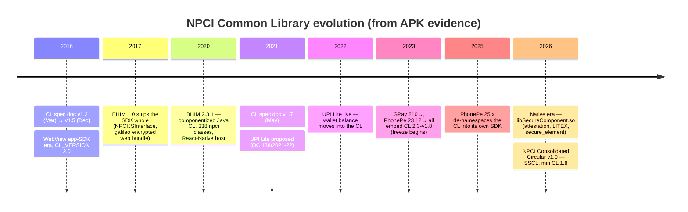

# The NPCI UPI Common Library: A Reverse-Engineering History (2016–2026)

**Project:** npc-cl-evolution · **Desk:** CashlessConsumer · **Date:** 2026-10-09
**Method:** static analysis (jadx decompilation + string/const extraction + binary hashing) of a 17-APK corpus spanning BHIM, Google Pay, and PhonePe from 2016 to 2026.

---

## 1. Executive summary

The UPI Common Library (CL) is the piece of code NPCI compiles and every PSP app embeds. It is the trust anchor on an untrusted phone: it draws the PIN pad, computes the cryptographic PIN block, holds the UPI Lite wallet balance, and since 2026 increasingly defends itself (device attestation, secure-element checks, native anti-tamper). Consumers never see it, but nothing happens on UPI without it.

Ten years of APKs tell a four-era story:

1. **Era 1 — The WebView SDK (2016–17,** `CL_VERSION = "2.0"`**).** The CL shipped as a *complete UPI app shell*: a WebView frontend (`in.org.npci.upiapp`), a JS bridge (`NPCIJSInterface`), the PIN component, and crypto — a white-label app NPCI handed to PSPs. BHIM 1.0 is this SDK plus branding assets encrypted on disk.
2. **Era 2 — The componentized Java CL (2019/20–2024,** `CL_VERSION = "2.3-v1.8"`**).** The CL became a library component (`in.org.npci.commonlibrary` + `org.npci.upi.security.pinactivitycomponent`) embedded in PSP-native apps. UPI Lite (2022) put the wallet *inside* the CL (`LITE_CL_VERSION = "2.3.lite-v1.8"`), with a SQLite store, key rotation, and its own constants. The version string then **froze at 2.3-v1.8 for \~3 years** across GPay (Jan 2023→Jan 2025) and PhonePe (Dec 2023→Nov 2024).
3. **Era 3 — The native CL (2025–2026).** PSPs replace the Java CL with a native binary, `libSecureComponent.so` (PhonePe 26.01 onward; Google Pay by 2026 — 0 `org.npci` Java classes remain). The native CL adds `setAttestationChallenge` (Play Integrity-class device checks), `secure_element` hooks, `OfflineNativeDefenderService`, and an `nEnableUPILITEX` flag. GPay and PhonePe ship *different builds of the same component* (same-arch binaries differ by 16 bytes).
4. **Era 4 — Server-side (2026).** NPCI's UPI Consolidated Circular v1.0 (18 Sep 2026) introduces the **Server-Side Common Library (SSCL) "hosted at NPCI end"** for conversational payments (Hello! UPI, 123Pay on feature phones), mandates a **minimum UPI CL version of 1.8** — which decodes to the Lite component's `1.8` minor in `2.3.lite-v1.8` — and formalizes UPI LITEX.

**The punchline for consumers:** the CL is migrating from *code on your phone* to *a service at NPCI*, with a decade-long detour through PSP apps that made your PIN security depend on your PSP's release cadence. The native era hardened the client but blinded public scrutiny (no more decompilable Java); the SSCL era recentralizes trust at NPCI. Both deserve watching.

---

## 2. What the CL is, in plain terms

Every UPI app on your phone (GPay, PhonePe, BHIM, WhatsApp Pay…) is built by a different company, but they all embed one component NPCI compiles and licenses: the **Common Library**. It is mandated: PSPs must integrate the CL and ship the version NPCI requires [^1]. Per NPCI's own product documentation, the UPI Lite balance "is reflected in the Common Library" of the app [^2]. In NPCI's specification language the CL is the component that

- renders the **secure PIN entry UI** so the host app never sees your PIN,
- fetches a **challenge** from the UPI system and computes the **PIN block** (encrypted credential) that travels to NPCI instead of your PIN,
- handles **device/MOBILE binding** metadata and key management,
- and since 2022, stores and manages the **UPI Lite wallet** on-device.

Everything else — contacts, QR scanning, offers, the pretty UI — belongs to the PSP. The CL is the part NPCI trusts.

## 3. Method and evidence base

### 3.1 Corpus

17 samples across three PSPs and ten years. Archive sources: archive.org `apkarchive` items [^3][^4][^5] (2016–2024 era), APKPure via `apkeep` for 2025–26 PhonePe [^6], ocitwo (Oracle Cloud Mumbai) as fetch vantage for archive.org direct-node downloads.

| Sample | App version | Approx. date | Source |
| --- | --- | --- | --- |
| bhim-1.0 | BHIM 1.0 | 2016/17 | archive.org `BHIM1.0` [^3] |
| bhim-2.3.1 | BHIM 2.3.1 | Jul 2020 | archive.org [^4] |
| gpay-210.1.2 … 225.1.3 | Google Pay (Tez lineage) | Jan 2023 → Jan 2025 | archive.org `apkarchive` [^5] |
| gpay-latest | Google Pay (current) | 2026 | APKPure |
| phonepe-23.12.22.0 → 24.11.29.0 | PhonePe | Dec 2023 → Nov 2024 | archive.org `apkarchive` [^5] |
| com.phonepe.app@25.05 → 26.09 | PhonePe | May 2025 → Sep 2026 | APKPure [^6] |

### 3.2 Pipeline

Per sample: unzip XAPK (base + config splits merged) → locate NPCI-bearing dexes via `org.npci`/`in.org.npci` class-table scan → scoped string dumps → jadx decompilation of key classes (`CLConstants`, `NPCIJSInterface`) → native-lib inventory + `.so` string extraction → sha256 of CL binaries → feature-marker matrix across all samples. Artifacts: `data/extracted/<sample>/`, `file data/markers_matrix.csv`, `file data/version-table.csv`, `file data/INVENTORY.md`.

### 3.3 Limits

Static analysis only: we see structure and strings, not runtime behavior. BHIM 2.3.1's R8-minified constants hide its exact CL version literal (recoverable in principle from smali const-uses). GPay's 2025–26 intermediate versions (between 225.1.3 and current) are not archived anywhere we could find — the native-migration date is bounded, not pinned. WhatsApp Pay, Cred, and other PSPs remain un-sampled.

## 4. Version semantics, decoded

The CL carries two version strings that mean different things, plus a documentation version that means a third:

| Identifier | Example (GPay 210, Jan 2023) | Meaning |
| --- | --- | --- |
| Public spec version | "CL Specifications v1.7" (2021-05-06) [^7] | The *document* version: 1.2 initial (22-03-2016), 1.5 (01-12-2016), 1.7 (2021) |
| `CL_VERSION` | `2.3-v1.8` | Library major 2.3, component release 1.8 |
| `LITE_CL_VERSION` | `2.3.lite-v1.8` | The UPI Lite module of the CL |
| `*_SUB_VERSION` | `2.3-v1.8_v1` | Sub-build |
| `ARQC_VERSION` | `1.0` | EMV-style cryptogram version (see §7) |

NPCI's Consolidated Circular v1.0 (Sep 2026) requires "certified and ensured minimum **1.8** UPI CL version" [^8] — read against the artifacts, that floor is the `1.8` component release embedded in `2.3-v1.8` / `2.3.lite-v1.8`, i.e. the state of the art as of early 2023. A three-year-old version is still the *minimum* regulators certify against in 2026 — the client CL moved slowly; the architecture around it moved fast.

## 5. The four eras

### Era 1 — The WebView app-SDK (2016–17): BHIM 1.0

BHIM 1.0 (`npci.bhim`) is not an app with a library inside; it is a **library with an app inside**. 148 NPCI-namespaced classes in three groups:

- `in.org.npci.upiapp` — a full UPI app shell: `HomeActivity`, `JsInterface`, `NPCIJSInterface`, `QRScannerInterface`.
- `in.org.npci.commonlibrary` — crypto and data utils (RSA/AES/SHA-256 plumbing).
- `org.npci.upi.security.pinactivitycomponent` — the PIN pad component with its own `CLConstants` (`CL_VERSION = "2.0"`).

The JS bridge (`NPCIJSInterface`) is the whole business API, and it is tiny: `initialiseNPCICL`, `handleInit`, `getChallenge`, `registerApp`, `getCredentials`, `fetchData`/`saveData`, `populateHMAC`, `trustCred`, `decodeNPCIXmlKeys`, `unbindNPCICL` — all wired through `CLServices`/`CLRemoteResultReceiver` IPC. The frontend itself ships as an **encrypted web bundle**: `file assets/galileo/index.html` boots with `JBridge.decryptAndloadFile("config.jsa")` — HTML, JS, and config are encrypted on disk (`index_bundle.jsa`) and decrypted into the WebView at runtime. `libnative-lib.so` carries JNI `Bhim::getChallenge` — even the challenge primitive was native from day one. Two gems in assets: `file npci_otp_rules.json` (regex rules for parsing bank OTP SMS: `"message": "is your OTP", "otp": "\\d{6}"`) and `cl-app.properties` documenting the **salted message format** `[txnId]|[commonLibraryVersion]|[txnAmount]|…` with versioned salt orderings.

This is the white-label era: a PSP could take NPCI's shell, reskin, and be UPI-compliant. BHIM 1.0's title string even reads "Bharat Pay" — the SDK predates the BHIM branding.

### Era 2 — The componentized Java CL (2019/20–2024): BHIM 2.3.1 → GPay 210–225 → PhonePe 23.12–24.11

BHIM 2.3.1 (Jul 2020) shows the CL matured into a serious component: 338 NPCI classes; `pinactivitycomponent` grew a full custom-UI stack (`widget/`, `Keypad`, `FormItemEditText`, `CLServerResultReceiver`); the host app moved to React Native (`libjsc.so`); R8 minification begins hiding constants.

From GPay 210 (Jan 2023) through PhonePe 24.11 (Nov 2024), every sampled app embeds the **same frozen version**: `CL_VERSION = "2.3-v1.8"`, `LITE_CL_VERSION = "2.3.lite-v1.8"`, `ARQC_VERSION = "1.0"`. The UPI Lite module is a first-class subsystem by this point: `LiteHelper`, `LiteState`, `LiteOnboarding`, `LiteBalance`, `LiteOpenHelper`/`LiteDatabase` (a SQLite store inside the CL — matching BHIM 2.3.1's `SQLiteOpenHelper` in the PIN component), `LITE_ACCOUNT_STATUS`, `LITE_TRANSACTION_LIMIT_FIELD`, `LITE_DEFAULT_CLIENT_RISKRULES`, and — notably — `ERROR_LITE_KEYS_ROTATION_NEEDED`: the CL anticipates Lite wallet **key rotation** failures as a first-class error.

Class counts stay eerily stable (GPay: 119–120 for two years; PhonePe: 138–140 for one year) — evidence of an NPCI-controlled drop, not per-PSP drift. The feature-marker matrix (`file data/markers_matrix.csv`) shows PSP-side capability language (CreditLine, ReservePay, conversational, Circle/delegate, international) ramping *around* the frozen CL.

### Era 3 — The native CL (2025–2026)

PhonePe 25.05/25.09 mark the transition: the `in.org.npci`/`org.npci` classes vanish from the namespace, but CL internals survive as obfuscated strings inside PhonePe's own SDK dexes (`CL_VERSION`, `CL_SUB_VERSION`, `LITE_CL_VERSION`, `CL_MESSAGES`, `CL_PROPERTIES`, `cl-messages`) — still `2.3-v1.8`. PhonePe re-badged the CL into its own codebase first.

By PhonePe 26.01 (Jan 2026) the Java CL is gone entirely, replaced by `libSecureComponent.so`:

| Binary | Sample | Arch | Size | sha256 (prefix) |
| --- | --- | --- | --- | --- |
| libSecureComponent.so | GPay current (2026) | armeabi-v7a | 778,584 | `d1d871a6a660b3dd…` |
| libSecureComponent.so | PhonePe 26.01 | armeabi-v7a | 778,568 | `4c48daffb97462e4…` |
| libSecureComponent.so | PhonePe 26.09 | arm64-v8a | 1,177,688 | `b5788da2d9cde721…` |

Same-architecture GPay and PhonePe binaries differ by **16 bytes** — the same component family, built per-PSP (embedded PSP identifier is the likely delta). Google Pay's 2026 app has **zero** NPCI Java classes; its 43 MB `libandroid_release_android_library_flutter_artifacts.so` is the Flutter-host bridge around the native CL.

The native CL's string surface names its new powers: `setAttestationChallenge` / `"Challenge mismatch!"` (device-integrity attestation), `secure_element` (hardware-backed storage), `org.npci.upi.security.securestorage` (a secure-storage package), `OfflineNativeDefenderService` (anti-tamper running even when the app doesn't), and `nEnableUPILITEX` — the flag for **UPI LITEX**, the Lite-offline capability formalized in the 2026 circular [^8]. Third-party verification exists: `52-1ab/opensc` reimplements `libSecureComponent.so` over OpenSSL and property-tests it against the JDK's own crypto [^9], and `librefin-in/cl-specification` maintains a public spec of the CL's internals [^10].

### Era 4 — Server-side (2026): SSCL

The UPI Consolidated Circular v1.0 (18 Sep 2026) introduces the **Server-Side Common Library "hosted at NPCI end"** for Conversational Payments (Hello! UPI voice, 123Pay feature-phone flows) [^8]. The same circular: UPI LITE rules (§18), Conversational Payments (§19), minimum CL 1.8 certification, UPI Circle delegates, credit lines, Reserve Pay, UPI ATM, international flows. The client CL's monopoly on "the secure UPI component" ends: for constrained devices, the CL is now a service NPCI runs.

## 6. Capability inventory (evidence-backed)

| Capability | BHIM 1.0 (2016/17) | BHIM 2.3.1 (2020) | GPay 210–225 (2023–25) | PhonePe 24.11 (2024) | Native era (2026) |
| --- | --- | --- | --- | --- | --- |
| CL version | `2.0` | (R8-hidden) | `2.3-v1.8` | `2.3-v1.8` | binary-only |
| PIN pad UI | Java + WebView | Java widget stack | Java widget stack | Java widget stack | native |
| Challenge crypto | JNI `getChallenge` | Java + JNI | Java | Java | native, attested |
| UPI Lite wallet | — | — | SQLite store + key rotation | same | `nEnableUPILITEX` |
| Device attestation | — | — | — | — | `setAttestationChallenge` |
| Secure element | — | — | — | — | `secure_element` |
| Anti-tamper service | — | — | — | — | `OfflineNativeDefenderService` |
| Host interface | JS bridge (11 methods) | IPC receiver | IPC receiver | IPC receiver | native bridge |
| Localization | `cl-messages*.properties` | same | same | same | native resources |
| OTP SMS parsing rules | in-app (`file npci_otp_rules.json`) | — | — | — | — |

The 269-field `CLConstants` of the 2.3 era (full list: `file data/extracted/gpay-210.1.2/clconstants_fields.txt`) is effectively the CL's self-description: request/response fields for account, balance, Lite, PIN, VPA, plus a large error-code taxonomy (`ERROR_*`), salt-field contracts (`SALT_FIELD_*`), and locale plumbing.

## 7. Security architecture, as evidenced

**PIN isolation.** The design goal — the host app never sees the PIN — is constant across eras: the PIN pad lives in NPCI's process boundary (`pinactivitycomponent`), returns an encrypted *block*, and communicates back via `CLReceiver`/`ResultReceiver` IPC (Era 1–2) or native bridge (Era 3). The USENIX 2020 analysis of UPI documents why this division matters: the PSP is the most exposed component, and the architecture's trust rests on the CL keeping credential material out of PSP reach [^11].

**The challenge exchange.** From the public spec line and third-party reconstructions [^9][^10]: the CL fetches a challenge, derives keys, encrypts the PIN block to an NPCI-held public key (RSA + AES per the v2.0 crypto spec), with per-transaction salt ordering (BHIM 1.0's `cl-app.properties` documents the versioned salt schemes explicitly).

**ARQC.** `ARQC_VERSION = "1.0"` in the 2.3-era constants is EMV-speak (Authorization Request Cryptogram) — evidence the CL computes card-network-style dynamic cryptograms, consistent with UPI's credential model, not just an encrypted PIN field.

**Hardening trajectory.** Era 1 ran on a WebView with OTP-SMS regexes in assets (the CL parsed your bank SMS). Era 3 runs native with attestation challenges, secure-element checks, and an always-on defender service. That is a decade of expanding self-defense — from "trust the process isolation" to "verify the device."

**Openness trade.** The Java era was publicly auditable by decompilation; the native era is not (though independent reimplementations exist [^9]). NPCI gains tamper-resistance; researchers lose observability. Archives like this one are the compensating control.

### 7.1 What the CL does *not* do: fraud triage and other-app detection

A recurring claim is that the CL "blocks UPI when it sees TeamViewer or a VPN." The artifacts say otherwise. Across every layer we examined:

- The 269-field `CLConstants` of the 2.3 era contains **zero** fraud-detection vocabulary — no screen-share, overlay, accessibility, VPN, remote-access, or block-list constants (full list: `file data/extracted/gpay-210.1.2/clconstants_fields.txt`).
- The decompiled `org.npci`/`in.org.npci` tree (338 classes, PhonePe 23.12) has no accessibility-service, screen-share, or app-enumeration code.
- The native `libSecureComponent.so` (2026) references `PackageManager`/`PackageInfo` generically (needed for host-identity attestation), and its detection strings are **self-defense only**: anti-frida (`frida-agent`), anti-debug (`ptrace`), root/tamper checks inside `OfflineNativeDefenderService`. It defends the CL; it does not surveil other apps.
- NPCI's UPI Consolidated Circular v1.0 (Sep 2026) contains no screen-sharing or other-app detection mandate either; NPCI's Mobile Application Security Framework (NPCI2025-26IS003, May 2025) mandates **RASP — the app defending itself** (root/jailbreak detection, hooking detection, device blocking after malicious behaviour) — not remote-access-app triage. [^12]

The screen-share/TeamViewer blocking consumers experience is implemented **above and beside the CL**:

1. **PSP app layer.** Google Pay surfaces 1M+ transaction warnings weekly and shows security warnings/blocks for unsafe device configurations [^13][^14]; PhonePe runs its own transaction risk-scoring engine ("high risk scores are automatically blocked" [^15]) and its dexes carry the app-enumeration primitives (`getRunningTasks`, `UsageStatsManager`, `queryIntentActivities`) — PSP-side code, not CL code.
2. **Android OS layer (2025+).** Google's screen-sharing fraud alerts (pilot with Navi, Paytm, Google Pay; Android 11+) warn during calls + screen-share + payment app open; on-device Gemini Nano call-scam detection (Pixel 9+, Hindi/English). [^14]
3. **Systemic layer.** NPCI banned P2P collect requests (Oct 2025), runs the Financial Fraud Risk Indicator (FRI) with DoT, and RBI's Authentication Mechanisms Directions (25 Sep 2025, effective 1 Apr 2026) formalize risk-based authentication.

The division of labor is consistent with the CL's decade-long design: the CL guards the *credential* (PIN block, Lite wallet, its own integrity); fraud triage belongs to the PSP's risk engine, the OS, and the network.

### 7.2 MASF (May 2025): the RASP mandate, and who carries it

The other-app / screen-share question is settled by NPCI's Mobile Application Security Framework — circular NPCI/2025-26/IS/003, 19 May 2025, building on NPCI2020-21PSO001 (RASP) and NPCI2024-25IS006 (SDK handling): 23 controls across Identify/Protect/Detect/Respond, certified annually by CERT-In empanelled auditors.[^12][^16] Mandated: root/jailbreak + cloaking detection, install-source validation, anti-debug, runtime integrity, SSL pinning, proxy detection, developer-options blocking, screen obfuscation, and **screen-mirroring prevention**. Merely recommended: harmful-app (blacklist) detection, emulator blocking, VPN detection, keylogger prevention, overlay prevention.[^17]

A 12-category string scan of current builds (all dexes + native libs; `data/rasp-matrix-2026.csv`, `notes/2026-10-09-masp-rasp-survey.md`) shows how apps implement it:

| Layer | GPay (2026) | PhonePe (26.09) | Airtel Thanks (2026) | WhatsApp (2026) | BHIM 2.3.1 (2020) |
|---|---|---|---|---|---|
| Commercial RASP SDK | **Promon** | **Promon** (59 hits) | none found | none found | — |
| Root / hook / emulator markers | 30 / 10 / 9 | 48 / 102 / 91 | 137 / 163 / 38 | 18 / 14 / 13 | 2 / 4 / 2 |
| Play Integrity refs | 9 | 83 | 4 | 6 | 0 |
| Screen-share APIs (MediaProjection/VirtualDisplay) | 46 | 4 | 13 | 371* | 0 |
| App-cloner watchlist in code | — | — | lbe.parallel, dualspace, shelter | shelter | — |
| VPN markers in code | 0 | 0 | 0 | 0 | 0 |

*WhatsApp's screen markers are its call screen-share feature, not fraud RASP. BHIM 2.3.1 is the pre-MASF baseline — near-zero RASP, which is the gap the 2020-21 → 2025 circular chain closed.

Reading: screen-share ("digital arrest") blocking is implemented as **RASP screen-mirroring detection** — the app checks whether its display is being projected (MediaProjection/VirtualDisplay state) and refuses to run the payment flow — not by enumerating installed apps. Installed-app blacklisting (where TeamViewer/AnyDesk *names* would appear) is only a recommended control, and neither big PSP's manifest requests `QUERY_ALL_PACKAGES` or lists remote-access apps in its targeted `<queries>` blocks (PhonePe's targeted list is root tools: SuperSU, Magisk-adjacent, RootCloak). VPN blocking, likewise recommended-only, shows zero client-side markers in any sampled app.

### 7.3 Certificates: what ships, and the expiry blind spot

Yes — the CL ships with certificates. Every sampled GPay and PhonePe build carries an NPCI cert at the APK root, and the 2026 builds carry two.

- **`signer.crt` / `signer-upi.crt`** — `CN=upinpci`, issued by IDRBT CA (the RBI-backed banking CA in Hyderabad). The CL extracts the public key from this cert and RSA-OAEP-wraps the challenge/key pipe for NPCI to unwrap server-side. NPCI re-issued the cert in Sep 2023 under IDRBT Sub CA 2022 (same public key, sha1 `aad46e0cd0c0`, since at least Jan 2022 — cert churn, key continuity).
- **`signer-erupee.crt`** (2026 builds only) — `CN=psosigner.npci.org.in`, a DigiCert EV cert for NPCI's organization-signing identity, for the e₨ rail. Two PKI lineages (banking-CA + public-CA) in one APK; first corpus evidence of e₨ sharing the UPI app's security plumbing.

The blind spot: **expiry is not enforced anywhere in the client path.** Pre-2026 builds shipped `signer.crt` 8–24 months past its 2024-01-19 expiry; all three certs in current 2026 builds are past `notAfter` (upi expired 2025-09, erupee expired 2024-10). An expired bundled CRT is still trusted because it isn't on the CRL — the cert works as a key container, not a validated chain. Trust is anchored in NPCI's distribution pipeline, not X.509 validation. Fine until the private key leaks; then there is no revocation machinery that actually bites. Full evidence table: `notes/2026-10-09-certificates.md`.

## 8. What this means for the person paying

- **Your PIN security is NPCI's code, but your update cadence is your PSP's.** The CL ships inside PSP apps; NPCI mandates minimum versions [^8], but enforcement lands only when the PSP ships an update. The 2023–25 version freeze at 2.3-v1.8 made this cheap; a real CL security release would mean millions of stale clients until PSPs roll out. Watch PSP release notes for CL bumps the way you watch OS updates.
- **UPI Lite balance lives in the CL on your device.** NPCI says so directly [^2]. It is convenient and offline-tolerant, but it is a wallet managed by app-embedded code — a lost/stale/wiped device state, key rotation errors (`ERROR_LITE_KEYS_ROTATION_NEEDED`), and Lite's no-chargeback nature [^8] all concentrate there.
- **The 2026 stack is stricter about your device.** Attestation (`setAttestationChallenge`) and secure-element checks mean rooted/unusual devices face new friction at the CL level — a security win that lands hardest on low-end and older hardware, the same devices SSCL/123Pay is meant to bring into UPI.
- **SSCL moves trust back to NPCI's servers.** For conversational and feature-phone payments, the "library" is a service at NPCI end [^8]. That simplifies the client story — and makes NPCI's server availability and governance part of your payment's critical path.

## 9. Open questions

1. **When exactly did each PSP cross to native?** GPay is bounded (Jan 2025 Java → 2026 native); PhonePe is pinned to 26.01. More archive.org submissions would pin both.
2. **Is** `libSecureComponent.so` **NPCI-built-and-distributed, or PSP-compiled from NPCI source?** The 16-byte same-arch delta says "same source, per-PSP build" — a per-PSP build registry would let anyone verify drift.
3. **What does LITEX change?** `nEnableUPILITEX` + the 2026 circular's LITEX rules suggest offline-Lite; the protocol is circular-level only.
4. **BHIM 2.3.1's exact CL version** (R8-hidden) and BHIM's current-generation CL packaging (BHIM is delisted from APKPure; needs a Play-side fetch).
5. **SSCL protocol surface** — circular-only today; a feature-phone UPI app teardown would be the natural next sample.

## 10. Reproduce it

Everything is scripted and parked in this project: `data/apks/` (corpus), `data/extracted/` (per-sample artifacts + `file _analysis_index.json`), `file data/markers_matrix.csv`, `file data/version-table.csv`, `file data/INVENTORY.md` (per-sample provenance + hashes), `file notes/2026-10-09-method.md` (pipeline log). Tools: `apkeep`, `jadx`, `apktool`, `strings`, `sha256sum`; ocitwo used as Indian vantage for archive.org direct-node fetches.

## Footnotes

[^1]: https://www.npci.org.in/what-we-do/upi/common-library
[^2]: https://www.npci.org.in/what-we-do/upi-lite/live-features
[^3]: https://archive.org/details/BHIM1.0
[^4]: https://archive.org/details/bhim-making-india-cashless_2.3.1
[^5]: https://archive.org/details/apkarchive (collection; items `google-pay-210.1.2` … `phone-pecom.phonepe.appv-24.11.29.0`)
[^6]: https://apkpure.com/com.phonepe.app/versions
[^7]: https://razorpay.com/docs/build/browser/assets/images/upi-common-library-spec-android-17.pdf
[^8]: https://avantiscdnprodstorage.blob.core.windows.net/legalupdatedocs/59640/NPCI-issued-the-UPI-Consolidated-Circular-Version-1-0-SEP182026.pdf
[^9]: https://github.com/52-1ab/opensc
[^10]: https://github.com/librefin-in/cl-specification
[^11]: https://arxiv.org/abs/2010.11731
[^12]: https://blog.certcube.com/npci-mobile-application-security-framework-for-upi
[^13]: https://support.google.com/pay/india/answer/16886058
[^14]: https://techcrunch.com/2025/11/20/google-steps-up-ai-scam-protection-in-india-but-gaps-remain
[^15]: https://www.phonepe.com/trust-and-safety[^16]: https://zimperium.com/blog/india-just-raised-the-bar-on-mobile-app-security
[^17]: https://blog.certcube.com/npcis-comprehensive-mobile-application-security-framework-for-upi-2025

**Addendum (2026-10-23).** Nemo (@captn3m0) published this finding publicly during the eMudhra distrust cycle — the discovery is his: UPI "running on an expired cert since Sep 2025, issued by IDRBT — which is now managing all of \*.bank.in", plus the eRupee signer parallel and the payload-encryption role clarification.[^18] Our own extraction (9 Oct, unpublished until now) matches his cert table exactly (upinpci 2023-09-20→2025-09-19; psosigner.npci.org.in →2024-10-01) — we followed with the corpus archaeology, not the other way round. ELI5 explainer: cashlessconsumer.zo.space/npci-expired-cert.

[^18]: https://x.com/captn3m0/status/2113563282040844699
